# WaveTrack

*Read this in [Português](README.pt-BR.md).*

**See who's in the office from the phones on your Wi-Fi.** WaveTrack notices when a registered phone or laptop shows up on the office network and turns that into a live dashboard, a daily timeline and attendance history. People register themselves with a QR code, nothing is installed on their phones, and nothing is tracked outside the office network.

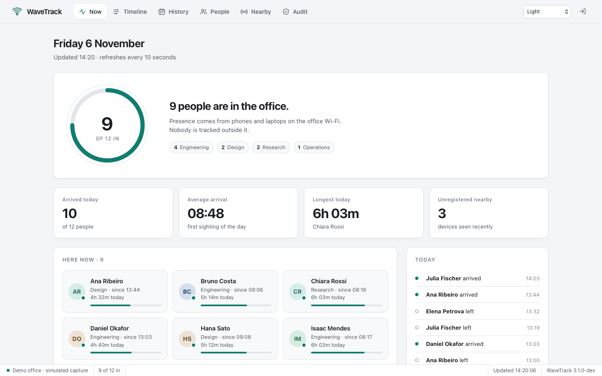

- **Now:** who's in, since when, and how long they've been here today.
- **Timeline:** every stay of the day as a bar, lunch breaks included.
- **History:** hours per person per day for 7, 14 or 30 days, exportable to CSV.
- **People:** self-registration by QR code, several devices per person, anonymize or erase on request.
- **Nearby:** devices seen recently that belong to nobody, ready to be assigned.
- **Audit:** every administrative action, who did it and from where, without keeping personal data.
- **Five sober themes**, from a clean light interface to a Windows-2000-style classic and a code-editor dark.
- A single Go binary with the dashboard built in, SQLite storage, optional HTTPS, and a demo mode that needs no setup.

## Contents

1. [Try it in one minute](#1-try-it-in-one-minute)
2. [Install](#2-install)
3. [First run](#3-first-run)
4. [Add people](#4-add-people)
5. [Day-to-day use](#5-day-to-day-use)
6. [Privacy](#6-privacy)
7. [Configuration](#7-configuration)
8. [Run it as a service](#8-run-it-as-a-service)
9. [How it works](#9-how-it-works)
10. [Security](#10-security)
11. [Performance](#11-performance)
12. [API](#12-api)
13. [Upgrading from 2.x](#13-upgrading-from-2x)
14. [Development](#14-development)

## 1. Try it in one minute

The demo simulates an office of twelve people with two weeks of history. It needs no capture permissions and leaves nothing behind. [Install](#2-install) WaveTrack, then:

```bash
wavetrack serve --demo
```

```
  WaveTrack 3.1.0 · running a simulated office
  Dashboard: http://localhost:8080

  Your admin access token (shown once, keep it safe):
    wt_gdrwbpc6ziucn3zaodujtfdz4jpkc6eo
  Or open http://localhost:8080/#token=wt_gdrwbpc6ziucn3zaodujtfdz4jpkc6eo to sign in directly.
```

Open the link it prints. Outside office hours the demo moves its clock to 14:20, and on weekends to Friday, so the office always looks busy.

## 2. Install

### One command

**macOS and Linux** (x64 and ARM64, so a Raspberry Pi works):

```bash
curl -fsSL https://raw.githubusercontent.com/lucasrafaldini/wavetrack/main/scripts/install.sh | sh
```

**Windows** (PowerShell):

```powershell
irm https://raw.githubusercontent.com/lucasrafaldini/wavetrack/main/scripts/install.ps1 | iex
```

Both download the latest [release](https://github.com/lucasrafaldini/wavetrack/releases), **verify it against the release's checksums** before installing, and install for your user without administrator rights. They end by listing what's left to do on your system (capture permission, libpcap or Npcap). Options: `--version 3.1.0` and `--prefix DIR` for `install.sh` (pass them after `sh -s --`), `-Version` and `-Destination` for `install.ps1`.

### By hand

Download the archive for your system from the [releases page](https://github.com/lucasrafaldini/wavetrack/releases), check it against `checksums.txt` and put `wavetrack` on your PATH. At run time it needs libpcap:

| System | libpcap |
| --- | --- |
| macOS | built in |
| Debian, Ubuntu, Raspberry Pi OS | `sudo apt install libpcap0.8` |
| Fedora | `sudo dnf install libpcap` |
| Windows | [Npcap](https://npcap.com), with "WinPcap API-compatible mode" checked |

### From source

You need Go 1.26 or newer, a C compiler and the libpcap headers (`libpcap-dev` on Debian and Ubuntu).

```bash
git clone https://github.com/lucasrafaldini/wavetrack.git
cd wavetrack
make build          # produces ./wavetrack
```

## 3. First run

### Step 1: pick the interface

```bash
wavetrack interfaces
```

```
Interfaces (the one WaveTrack would pick is marked →):
  → en1        Wi-Fi  up    192.168.15.20
    en0        wired  up    192.168.15.15
  (16 virtual or unconnected interfaces hidden; --all shows them)
```

WaveTrack picks the connected Wi-Fi interface on its own. It never guesses a wired port, but you can choose one with `--interface en0`: when Wi-Fi and wired devices share one network, phones' broadcasts reach the wired port too.

### Step 2: check permissions

Reading network traffic needs permission. `wavetrack doctor` checks everything and says exactly what to do:

```
WaveTrack 3.1.0 on darwin/arm64

  ✓ configuration: defaults (config.yaml not found)
  ✓ libpcap version 1.10.1
  ✓ capture interface: en0
  ✗ permission to capture on en0
      Run WaveTrack with sudo, or grant capture permission once:
      brew install --cask wireshark-chmodbpf   (then log out and back in)
  ✓ data directory ./data is writable
  ✓ dashboard address :8080 is free
```

Granting permission once is better than running as root, because the database stays owned by you:

- **macOS:** `brew install --cask wireshark-chmodbpf`, then log out and back in.
- **Linux:** `sudo setcap cap_net_raw,cap_net_admin=eip "$(command -v wavetrack)"`
- **Windows:** installing Npcap is enough; otherwise run from an Administrator prompt.

### Step 3: start it and sign in

```bash
wavetrack
```

The first start prints an admin access token, once; only its hash is stored. Open the dashboard and paste it, or use the sign-in link it prints. Lost it? `wavetrack token reset` issues a new one and signs every browser out.

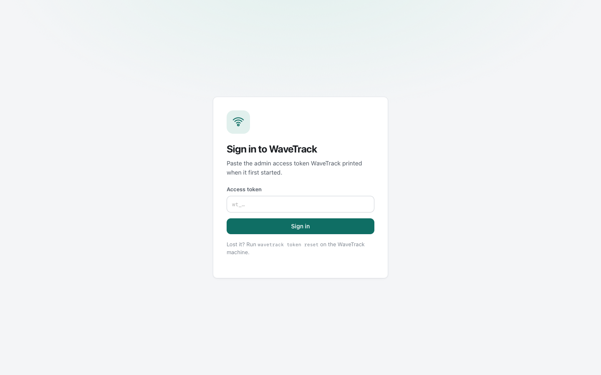

## 4. Add people

### Option A: a QR invite (recommended)

On **People**, choose **Invite with QR code**. Each invite works for one person, for 24 hours.

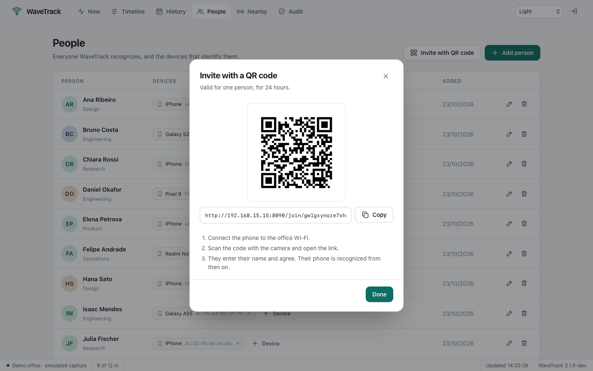

The person connects to the office Wi-Fi, scans the code, enters their name and agrees. WaveTrack identifies their phone from the network itself; it never trusts an address the phone claims.

| Light | Dark |
| --- | --- |
| 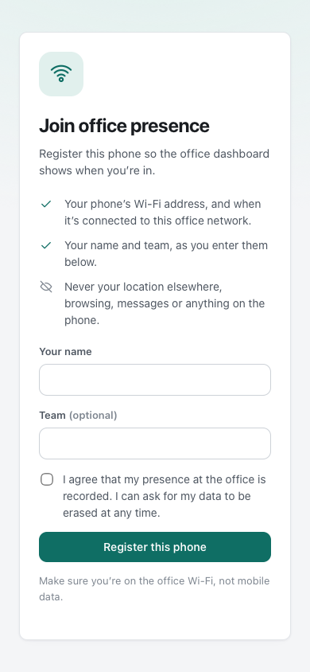 | 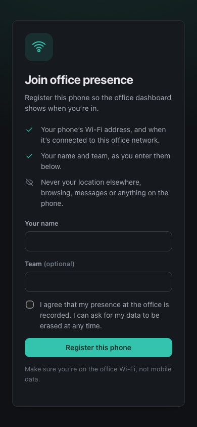 |

The page states what is recorded and what isn't, and registration needs explicit consent.

### Option B: add them yourself

**Add person** takes a name, a team and, optionally, a device's MAC address. On an iPhone it's in *Settings › Wi-Fi › ⓘ › Wi-Fi Address*; on Android, in the network's details.


Anyone can have several devices: any of them being seen counts as them being here.

### Option C: assign from Nearby

**Nearby** lists devices seen recently that belong to nobody, with their maker and signal. Pick a person from the menu to assign one.

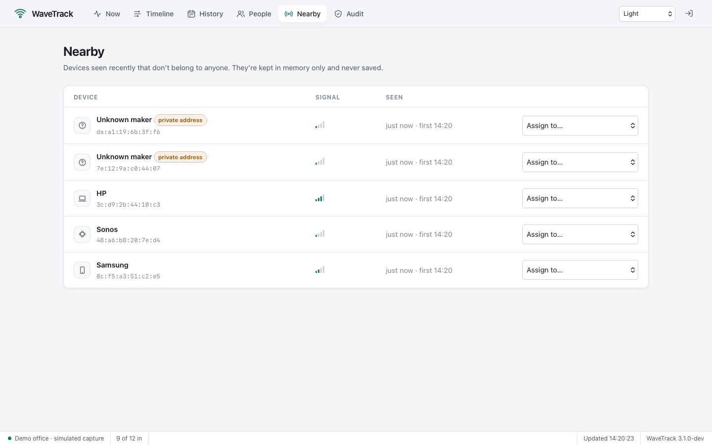

Phones use *private addresses*: random, but stable on a given network. They work for presence; WaveTrack labels them because their maker can't be known.

## 5. Day-to-day use

### Now

Who's in, since when, and how long they've been here today. The **Today** column lists the day's arrivals and departures. The page refreshes every 10 seconds.

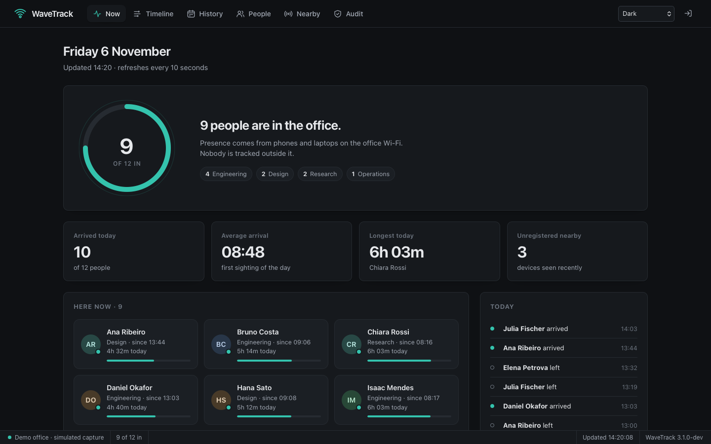

### Timeline

One bar per stay, from the first sighting to the last; the red line is now. Use the arrows to browse other days.

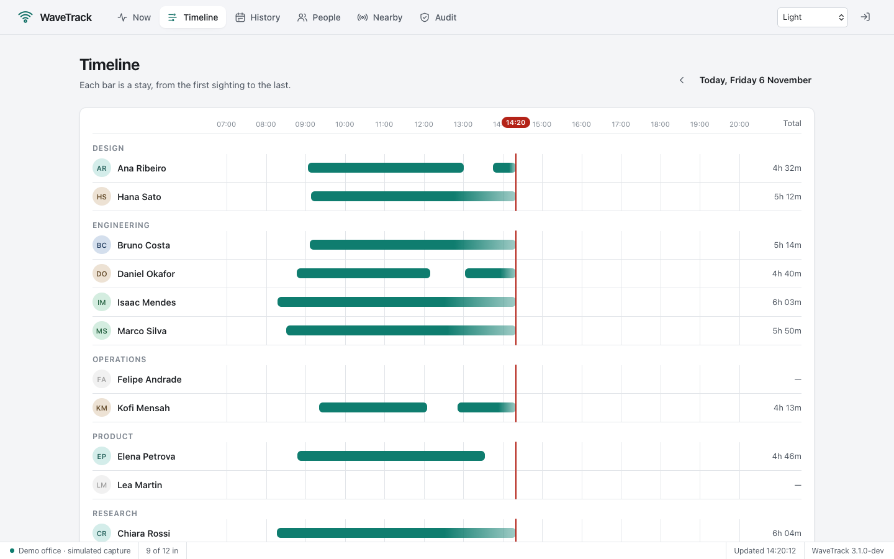

### History

Hours on site per day. A full cell is an 8-hour day; hover a cell for arrival and departure times. **Export CSV** downloads the same data for a spreadsheet.

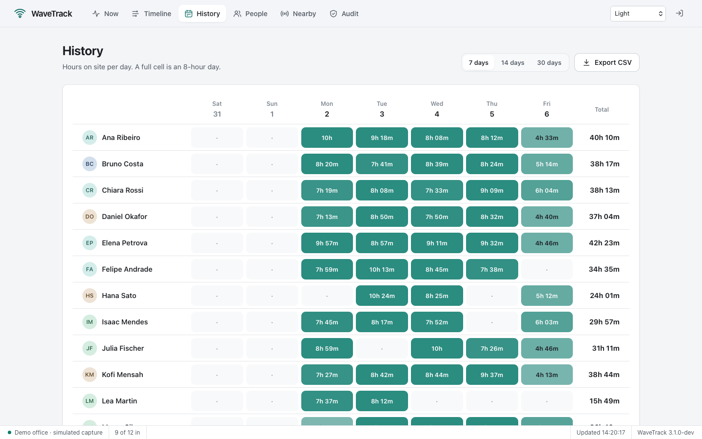

### Audit

Every administrative action, newest first: sign-ins (failed ones included), people added, edited, anonymized or erased, devices, invites and exports. Each entry says which browser session did it and from which address. Filter by kind, load older entries, or export the log as CSV.

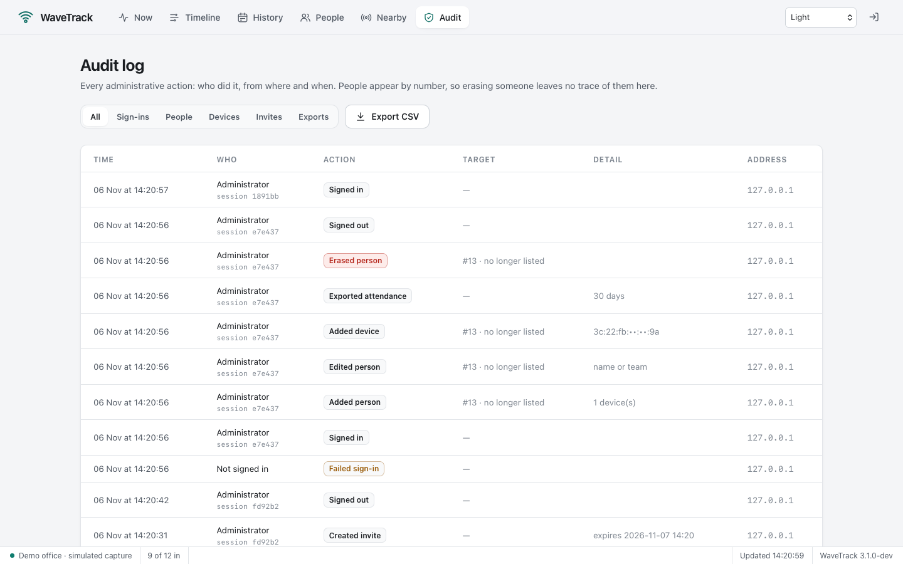

People appear by number (the page shows their current name next to it), and devices with their middle octets masked. Erasing someone therefore leaves nothing personal behind in the log, while the record of the erasure stays.

### Themes

Pick a theme from the menu in the top bar; the choice is remembered per browser. **System** follows the operating system's light or dark appearance.

| Light | Dark |
| --- | --- |
|  |  |
| **Classic**: a Windows 2000 desktop application | **Code**: a code editor's dark chrome |
| 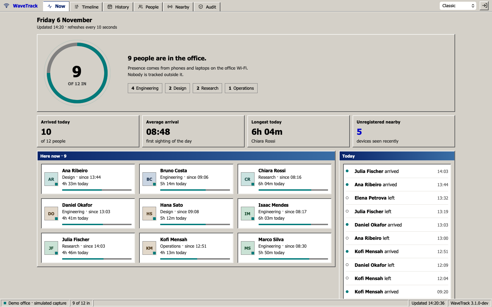 | 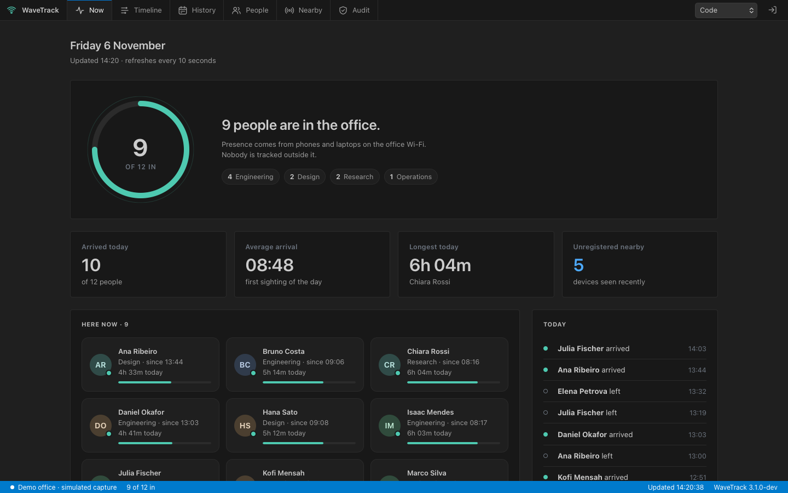 |

**High contrast** uses black, white and saturated signal colors, for low vision and bright rooms.

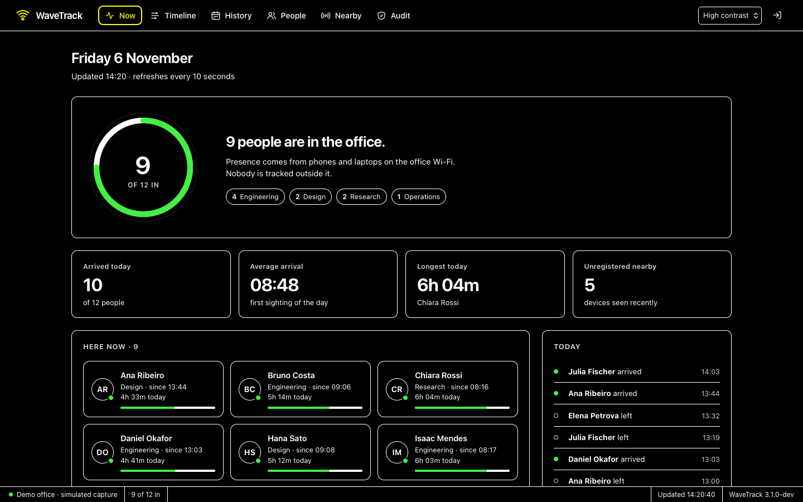

Presence keeps its own color in every theme, so a colored bar or dot always means "in the office".

### On a phone

The dashboard is responsive; the status bar keeps only what fits.


## 6. Privacy

Presence data is personal data. WaveTrack is designed so the right thing is the default.

- **Only registered devices are stored.** Devices that belong to nobody live in memory for a short while (for Nearby) and are never written to disk.
- **Consent is recorded.** People who register themselves agree first, and the date is kept.
- **Two ways to remove someone.** *Anonymize* replaces their name and forgets their devices but keeps past hours, so totals stay right. *Erase everything* deletes the person, their devices and every visit, for data-deletion requests under LGPD or GDPR.

  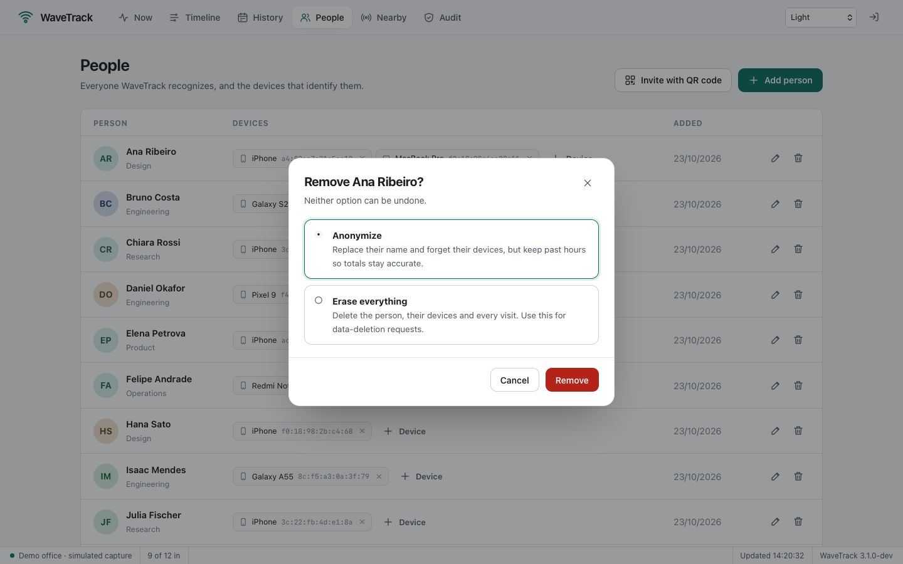

- **Retention.** Visits older than `privacy.retention_days` (365 by default) are deleted automatically, and audit entries after `privacy.audit_retention_days` (730).
- **Accountability.** The [audit log](#audit) records who did what, without storing names or full device addresses.
- **Nothing leaves the building.** No accounts, no cloud, no telemetry. The only outbound request is a download of the IEEE manufacturer list, used to label devices.
- **Locked-down dashboard.** Access needs the admin token; sessions use `HttpOnly`, `SameSite=Strict` cookies; requests from other sites are refused; a strict Content Security Policy blocks injected scripts; sign-in attempts are rate-limited; HTTPS is one setting away. See [Security](#10-security).

Make sure your use complies with local law and is known to the people in the office.

## 7. Configuration

Everything is optional. Copy [`config.example.yaml`](config.example.yaml) to `config.yaml` to change something.

| Setting | Default | Meaning |
| --- | --- | --- |
| `listen` | `:8080` | Dashboard address. Phones need to reach it for invites. |
| `public_url` | detected | Base URL for invite links, e.g. behind a reverse proxy. |
| `data_dir` | `./data` | Where the SQLite database lives (created readable by its owner only). |
| `tls.cert_file`, `tls.key_file` | empty | Serve the dashboard over HTTPS. Both or neither. |
| `capture.interface` | Wi-Fi | Interface to watch. |
| `capture.monitor_mode` | `false` | Capture raw 802.11 frames, adding signal strength. Needs a supporting adapter. |
| `presence.away_after` | `20m` | Unseen this long means gone. Phones nap to save battery, so keep it above 15m. |
| `presence.min_signal_dbm` | `-85` | Monitor mode only: ignore weaker devices, e.g. passers-by. |
| `privacy.retention_days` | `365` | Delete older visits; `0` keeps them forever. |
| `privacy.audit_retention_days` | `730` | Delete older audit entries; `0` keeps them forever. |

Command-line flags `--interface`, `--listen`, `--data` and `--monitor` override the file.

## 8. Run it as a service

- **Linux (systemd):** [`deploy/systemd/wavetrack.service`](deploy/systemd/wavetrack.service) runs WaveTrack as an unprivileged user with only the two capabilities capture needs, no access to home directories, kernel settings or other network families, and a private umask. The steps are at the top of the file.
- **macOS (launchd):** [`deploy/launchd/com.lucasrafaldini.wavetrack.plist`](deploy/launchd/com.lucasrafaldini.wavetrack.plist) starts it at boot.

A Raspberry Pi on the office network is plenty.

## 9. How it works

Phones and laptops on a network constantly announce themselves, even when idle: ARP, DHCP, IPv6 neighbor discovery and mDNS. WaveTrack listens for those packets on one interface, notes the sender's hardware address, and turns sightings into **visits**: a visit starts at the first sighting and ends at the last one, once nothing has been seen for `away_after`.

```
packets ─▶ capture ─▶ sightings ─▶ presence tracker ─▶ visits (SQLite) ─▶ reports ─▶ dashboard
             │ one per device                 │                                   ▲
             │ every 15s at most               └─▶ nearby (memory only) ──────────┘
```

The design decisions behind it (why visits instead of events, why departures are back-dated, how invites are made race-free) are in [docs/architecture.md](docs/architecture.md).

## 10. Security

WaveTrack holds personal data and runs with packet-capture rights, so it was reviewed as such. The [security review](docs/security.md) has the threat model, every control, the findings of the 3.1 review and what was done about each, and the risks accepted on purpose. In short:

- **Sign-in:** a 160-bit admin token stored hashed; `HttpOnly`, `SameSite=Strict` sessions; 10 attempts a minute per address.
- **Requests:** same-origin JSON only; strict Content Security Policy and cross-origin isolation headers; bounded timeouts and sizes.
- **Transport:** HTTPS with HSTS when `tls:` is configured. Use it whenever the office Wi-Fi is shared.
- **Data:** a database only its owner can read; strangers' devices never stored; retention for visits and audit entries.
- **Accountability:** an audit log of every administrative action.
- **Supply chain:** five direct dependencies, abandoned ones replaced by their maintained successors; `govulncheck` and `staticcheck` in CI.

To report a vulnerability, see [SECURITY.md](SECURITY.md).

## 11. Performance

Measured over an office of 100 people with a year of history (details and method in [docs/benchmarks.md](docs/benchmarks.md)):

| | 3.0 | 3.1 |
| --- | ---: | ---: |
| Dashboard refresh (`/api/now`) | 5.8 ms | **0.42 ms** |
| Ten dashboards refreshing at once, per request | 6.3 ms | **0.16 ms** |
| Today's visits, with a year of history | 5.6 ms | **0.10 ms** |
| Full-year CSV export | 152 ms | 157 ms |

Reads no longer scan the history and no longer wait for each other. Reproduce with `make bench`.

## 12. API

Everything the dashboard shows comes from a JSON API under `/api`, authenticated by the same session cookie.

| Endpoint | Purpose |
| --- | --- |
| `GET /api/status` | What is being captured, version, people in |
| `GET /api/now` | People with presence, today's totals and events |
| `GET /api/timeline?date=YYYY-MM-DD` | A day's stays per person |
| `GET /api/history?days=7` | Daily totals, up to 31 days |
| `GET /api/export.csv?days=30` | The same as CSV |
| `GET /api/nearby` | Unregistered devices seen recently |
| `GET, POST /api/people` · `PATCH, DELETE /api/people/{id}` | Manage people (`DELETE ?mode=archive\|erase`) |
| `POST /api/people/{id}/devices` · `DELETE /api/devices/{mac}` | Manage devices |
| `POST /api/invites` | Create a QR invite |
| `GET /api/audit?action=person.&before=ID&limit=100` | Audit entries, newest first (`action` takes an exact action or a prefix ending in `.`) |
| `GET /api/audit.csv` | The whole audit log as CSV |

## 13. Upgrading from 2.x

Version 3 is a rewrite with a new database layout. Import your people and history once:

```bash
wavetrack import-v2 data/wavetrack.db --data data-v3
wavetrack --data data-v3
```

Arrivals are paired with the following departure; arrivals without one are skipped, because 2.x recorded departures unreliably. See the [changelog](CHANGELOG.md) for everything that changed.

## 14. Development

```bash
make test     # Go tests with the race detector, plus a syntax check of the dashboard scripts
make lint     # go vet, gofmt and staticcheck
make audit    # govulncheck: known vulnerabilities in the code paths WaveTrack calls
make bench    # every benchmark, six runs, into bench.txt
make demo     # build and run the demo
```

The dashboard is plain HTML, CSS and JavaScript in [`web/`](web), compiled into the binary; there is no build step. Themes are sets of CSS custom properties at the top and bottom of [`app.css`](web/assets/app.css). Documentation screenshots are generated from the demo with `swift scripts/screenshot.swift` (macOS), which takes a theme per shot, e.g. `audit=/audit:classic`.

MIT License · Lucas Rafaldini
