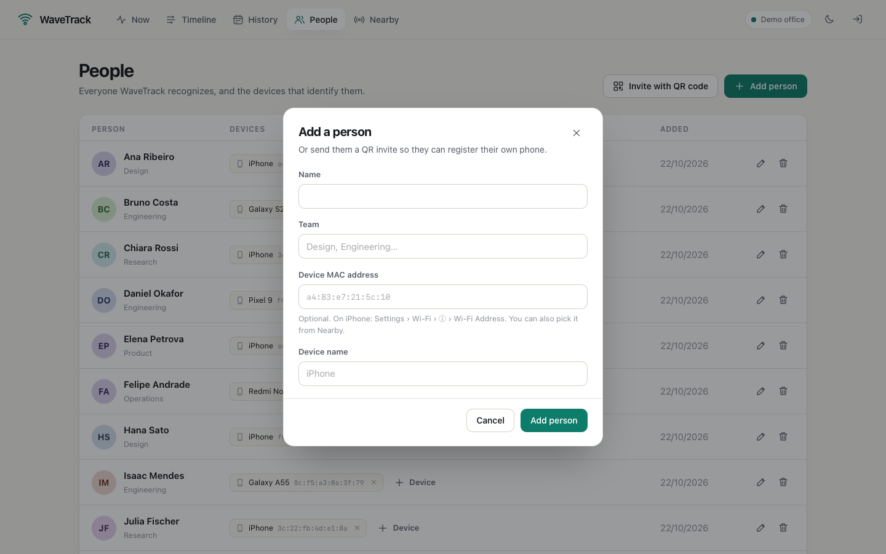
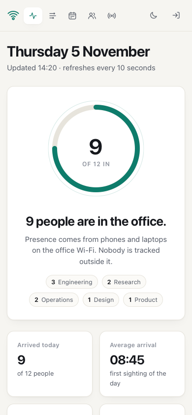

# WaveTrack

*Read this in [Português](README.pt-BR.md).*

**See who's in the office from the phones on your Wi-Fi.** WaveTrack notices when a registered phone or laptop shows up on the office network and turns that into a live dashboard, a daily timeline and attendance history. People register themselves with a QR code, nothing is installed on their phones, and nothing is tracked outside the office network.


- **Now:** who's in, since when, and how long they've been here today.
- **Timeline:** every stay of the day as a bar, lunch breaks included.
- **History:** hours per person per day for 7, 14 or 30 days, exportable to CSV.
- **People:** self-registration by QR code, several devices per person, anonymize or erase on request.
- **Nearby:** devices seen recently that belong to nobody, ready to be assigned.
- A single Go binary with the dashboard built in, SQLite storage, and a demo mode that needs no setup.

## Contents

1. [Try it in one minute](#1-try-it-in-one-minute)
2. [Install](#2-install)
3. [First run](#3-first-run)
4. [Add people](#4-add-people)
5. [Day-to-day use](#5-day-to-day-use)
6. [Privacy](#6-privacy)
7. [Configuration](#7-configuration)
8. [Run it as a service](#8-run-it-as-a-service)
9. [How it works](#9-how-it-works)
10. [API](#10-api)
11. [Upgrading from 2.x](#11-upgrading-from-2x)
12. [Development](#12-development)

## 1. Try it in one minute

The demo simulates an office of twelve people with two weeks of history. It needs no capture permissions and leaves nothing behind.

```bash
git clone https://github.com/lucasrafaldini/wavetrack.git
cd wavetrack
make demo
```

```
  WaveTrack 3.0.0 · running a simulated office
  Dashboard: http://localhost:8080

  Your admin access token (shown once, keep it safe):
    wt_gdrwbpc6ziucn3zaodujtfdz4jpkc6eo
  Or open http://localhost:8080/#token=wt_gdrwbpc6ziucn3zaodujtfdz4jpkc6eo to sign in directly.
```

Open the link it prints. Outside office hours the demo moves its clock to 14:20, so the office always looks busy.

## 2. Install

You need Go 1.23 or newer and libpcap.

| System | libpcap |
| --- | --- |
| macOS | already included with the Xcode Command Line Tools |
| Debian, Ubuntu, Raspberry Pi OS | `sudo apt install libpcap-dev` |
| Fedora | `sudo dnf install libpcap-devel` |

```bash
git clone https://github.com/lucasrafaldini/wavetrack.git
cd wavetrack
make build          # produces ./wavetrack
```

Prebuilt binaries for Linux (amd64) and macOS (Apple silicon and Intel) are attached to each [release](https://github.com/lucasrafaldini/wavetrack/releases).

## 3. First run

### Step 1: pick the interface

```bash
./wavetrack interfaces
```

```
Interfaces (the one WaveTrack would pick is marked →):
  → en1        Wi-Fi  up    192.168.15.20
    en0        wired  up    192.168.15.15
  (16 virtual or unconnected interfaces hidden; --all shows them)
```

WaveTrack picks the connected Wi-Fi interface on its own. It never guesses a wired port, but you can choose one with `--interface en0`: when Wi-Fi and wired devices share one network, phones' broadcasts reach the wired port too.

### Step 2: check permissions

Reading network traffic needs permission. `wavetrack doctor` checks everything and says exactly what to do:

```
WaveTrack 3.0.0 on darwin/arm64

  ✓ configuration: defaults (config.yaml not found)
  ✓ libpcap version 1.10.1
  ✓ capture interface: en0
  ✗ permission to capture on en0
      Run WaveTrack with sudo, or grant capture permission once:
      brew install --cask wireshark-chmodbpf   (then log out and back in)
  ✓ data directory ./data is writable
  ✓ dashboard address :8080 is free
```

Granting permission once is better than running as root, because the database stays owned by you:

- **macOS:** `brew install --cask wireshark-chmodbpf`, then log out and back in.
- **Linux:** `sudo setcap cap_net_raw,cap_net_admin=eip ./wavetrack`

### Step 3: start it and sign in

```bash
./wavetrack
```

The first start prints an admin access token, once; only its hash is stored. Open the dashboard and paste it, or use the sign-in link it prints. Lost it? `./wavetrack token reset` issues a new one and signs every browser out.


## 4. Add people

### Option A: a QR invite (recommended)

On **People**, choose **Invite with QR code**. Each invite works for one person, for 24 hours.


The person connects to the office Wi-Fi, scans the code, enters their name and agrees. WaveTrack identifies their phone from the network itself; it never trusts an address the phone claims.

| Light | Dark |
| --- | --- |
|  |  |

The page states what is recorded and what isn't, and registration needs explicit consent.

### Option B: add them yourself

**Add person** takes a name, a team and, optionally, a device's MAC address. On an iPhone it's in *Settings › Wi-Fi › ⓘ › Wi-Fi Address*; on Android, in the network's details.



Anyone can have several devices: any of them being seen counts as them being here.

### Option C: assign from Nearby

**Nearby** lists devices seen recently that belong to nobody, with their maker and signal. Pick a person from the menu to assign one.


Phones use *private addresses*: random, but stable on a given network. They work for presence; WaveTrack labels them because their maker can't be known.

## 5. Day-to-day use

### Now

Who's in, since when, and how long they've been here today. The **Today** column lists the day's arrivals and departures. The page refreshes every 10 seconds.


### Timeline

One bar per stay, from the first sighting to the last; the red line is now. Use the arrows to browse other days.


### History

Hours on site per day. A full cell is an 8-hour day; hover a cell for arrival and departure times. **Export CSV** downloads the same data for a spreadsheet.


### On a phone

The dashboard is responsive, and follows the system's light or dark appearance (the moon button overrides it).



## 6. Privacy

Presence data is personal data. WaveTrack is designed so the right thing is the default.

- **Only registered devices are stored.** Devices that belong to nobody live in memory for a short while (for Nearby) and are never written to disk.
- **Consent is recorded.** People who register themselves agree first, and the date is kept.
- **Two ways to remove someone.** *Anonymize* replaces their name and forgets their devices but keeps past hours, so totals stay right. *Erase everything* deletes the person, their devices and every visit, for data-deletion requests under LGPD or GDPR.

  

- **Retention.** Visits older than `privacy.retention_days` (365 by default) are deleted automatically.
- **Nothing leaves the building.** No accounts, no cloud, no telemetry. The only outbound request is a download of the IEEE manufacturer list, used to label devices.
- **Locked-down dashboard.** Access needs the admin token; sessions use `HttpOnly`, `SameSite=Strict` cookies; requests from other sites are refused; a strict Content Security Policy blocks injected scripts.

Make sure your use complies with local law and is known to the people in the office.

## 7. Configuration

Everything is optional. Copy [`config.example.yaml`](config.example.yaml) to `config.yaml` to change something.

| Setting | Default | Meaning |
| --- | --- | --- |
| `listen` | `:8080` | Dashboard address. Phones need to reach it for invites. |
| `public_url` | detected | Base URL for invite links, e.g. behind a reverse proxy. |
| `data_dir` | `./data` | Where the SQLite database lives. |
| `capture.interface` | Wi-Fi | Interface to watch. |
| `capture.monitor_mode` | `false` | Capture raw 802.11 frames, adding signal strength. Needs a supporting adapter. |
| `presence.away_after` | `20m` | Unseen this long means gone. Phones nap to save battery, so keep it above 15m. |
| `presence.min_signal_dbm` | `-85` | Monitor mode only: ignore weaker devices, e.g. passers-by. |
| `privacy.retention_days` | `365` | Delete older visits; `0` keeps them forever. |

Command-line flags `--interface`, `--listen`, `--data` and `--monitor` override the file.

## 8. Run it as a service

- **Linux (systemd):** [`deploy/systemd/wavetrack.service`](deploy/systemd/wavetrack.service) runs WaveTrack as an unprivileged user with only the two capabilities capture needs. The steps are at the top of the file.
- **macOS (launchd):** [`deploy/launchd/com.lucasrafaldini.wavetrack.plist`](deploy/launchd/com.lucasrafaldini.wavetrack.plist) starts it at boot.

A Raspberry Pi on the office network is plenty.

## 9. How it works

Phones and laptops on a network constantly announce themselves, even when idle: ARP, DHCP, IPv6 neighbor discovery and mDNS. WaveTrack listens for those packets on one interface, notes the sender's hardware address, and turns sightings into **visits**: a visit starts at the first sighting and ends at the last one, once nothing has been seen for `away_after`.

```
packets ─▶ capture ─▶ sightings ─▶ presence tracker ─▶ visits (SQLite) ─▶ reports ─▶ dashboard
             │ one per device                 │                                   ▲
             │ every 15s at most               └─▶ nearby (memory only) ──────────┘
```

The design decisions behind it (why visits instead of events, why departures are back-dated, how invites are made race-free) are in [docs/architecture.md](docs/architecture.md).

## 10. API

Everything the dashboard shows comes from a JSON API under `/api`, authenticated by the same session cookie.

| Endpoint | Purpose |
| --- | --- |
| `GET /api/now` | People with presence, today's totals and events |
| `GET /api/timeline?date=YYYY-MM-DD` | A day's stays per person |
| `GET /api/history?days=7` | Daily totals, up to 31 days |
| `GET /api/export.csv?days=30` | The same as CSV |
| `GET /api/nearby` | Unregistered devices seen recently |
| `GET, POST /api/people` · `PATCH, DELETE /api/people/{id}` | Manage people (`DELETE ?mode=archive\|erase`) |
| `POST /api/people/{id}/devices` · `DELETE /api/devices/{mac}` | Manage devices |
| `POST /api/invites` | Create a QR invite |

## 11. Upgrading from 2.x

Version 3 is a rewrite with a new database layout. Import your people and history once:

```bash
./wavetrack import-v2 data/wavetrack.db --data data-v3
./wavetrack --data data-v3
```

Arrivals are paired with the following departure; arrivals without one are skipped, because 2.x recorded departures unreliably. See the [changelog](CHANGELOG.md) for everything that changed.

## 12. Development

```bash
make test     # Go tests with the race detector, plus a syntax check of the dashboard scripts
make lint     # go vet and gofmt
make demo     # build and run the demo
```

The dashboard is plain HTML, CSS and JavaScript in [`web/`](web), compiled into the binary; there is no build step. Documentation screenshots are generated from the demo with `swift scripts/screenshot.swift` (macOS).

MIT License · Lucas Rafaldini
