# WaveTrack

*Leia em [English](README.md).*

**Veja quem está no escritório pelos celulares no Wi-Fi.** O WaveTrack percebe quando um celular ou notebook cadastrado aparece na rede do escritório e transforma isso em um painel ao vivo, uma linha do tempo do dia e um histórico de presença. As pessoas se cadastram sozinhas com um QR code, nada é instalado no celular delas e nada é rastreado fora da rede do escritório.

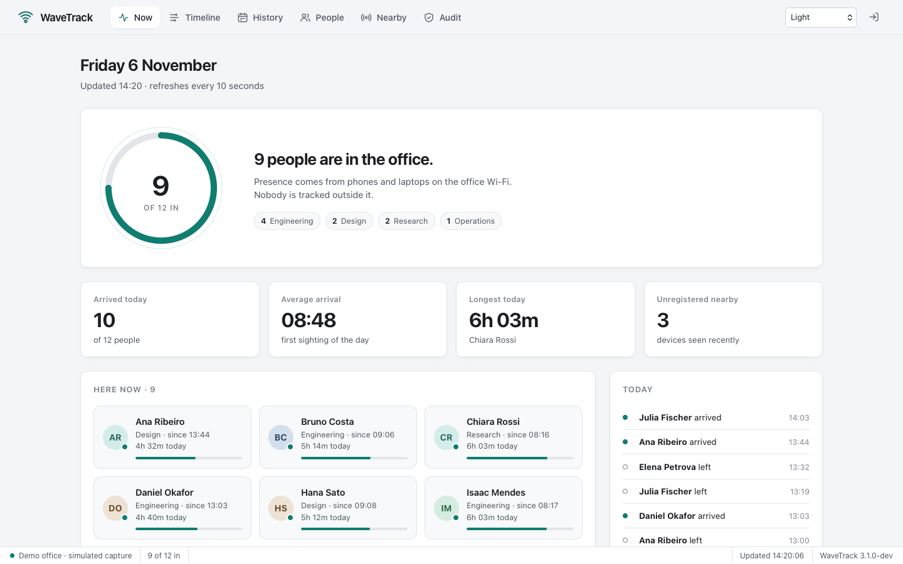

- **Agora:** quem está, desde quando e há quanto tempo hoje.
- **Linha do tempo:** cada permanência do dia como uma barra, inclusive o almoço.
- **Histórico:** horas por pessoa por dia, em 7, 14 ou 30 dias, exportável em CSV.
- **Pessoas:** cadastro por QR code, vários aparelhos por pessoa, anonimizar ou apagar a pedido.
- **Por perto:** aparelhos vistos recentemente que não pertencem a ninguém, prontos para atribuir.
- **Auditoria:** cada ação administrativa, quem fez e de onde, sem guardar dados pessoais.
- **Cinco temas sóbrios**, de uma interface clara e limpa a um clássico estilo Windows 2000 e um escuro de editor de código.
- Um único binário em Go com o painel embutido, SQLite, HTTPS opcional e um modo demo que não exige configuração.

## 1. Experimente em um minuto

Depois de [instalar](#2-instalação), rode o demo: um escritório simulado de doze pessoas com duas semanas de histórico, sem precisar de permissões de captura.

```bash
wavetrack serve --demo
```

Abra o link que ele imprime. Fora do horário comercial o relógio do demo vai para as 14h20, e nos fins de semana para sexta-feira, para o escritório sempre parecer movimentado.

## 2. Instalação

**macOS e Linux** (x64 e ARM64, inclusive Raspberry Pi), com um comando:

```bash
curl -fsSL https://raw.githubusercontent.com/lucasrafaldini/wavetrack/main/scripts/install.sh | sh
```

**Windows** (PowerShell):

```powershell
irm https://raw.githubusercontent.com/lucasrafaldini/wavetrack/main/scripts/install.ps1 | iex
```

Os dois baixam a última [release](https://github.com/lucasrafaldini/wavetrack/releases), **conferem o checksum** antes de instalar, instalam para o seu usuário sem pedir administrador e terminam dizendo o que falta no seu sistema (permissão de captura, libpcap ou Npcap).

Também dá para baixar o arquivo da release à mão, ou compilar com Go 1.26+, um compilador C e os headers da libpcap (`libpcap-dev` no Debian/Ubuntu): `make build`.

## 3. Primeira execução

1. **Escolha a interface:** `wavetrack interfaces` mostra as opções. O WaveTrack escolhe sozinho o Wi-Fi conectado e nunca adivinha uma porta cabeada; se o Wi-Fi e a rede cabeada forem a mesma rede, `--interface en0` também funciona.
2. **Confira as permissões:** `wavetrack doctor` verifica tudo e diz exatamente o que fazer. Prefira conceder a permissão uma vez a rodar como root:
   - **macOS:** `brew install --cask wireshark-chmodbpf` e depois saia e entre na sessão.
   - **Linux:** `sudo setcap cap_net_raw,cap_net_admin=eip "$(command -v wavetrack)"`
   - **Windows:** basta o Npcap instalado; sem ele, rode num prompt de Administrador.
3. **Inicie e entre:** `wavetrack`. A primeira execução imprime, uma única vez, o token de administrador (só o hash dele é guardado). Perdeu? `wavetrack token reset`.

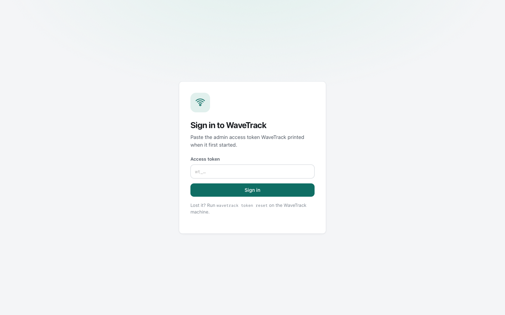

## 4. Cadastre as pessoas

**Opção A, convite por QR (recomendado).** Em **People**, clique em **Invite with QR code**. Cada convite vale para uma pessoa, por 24 horas.

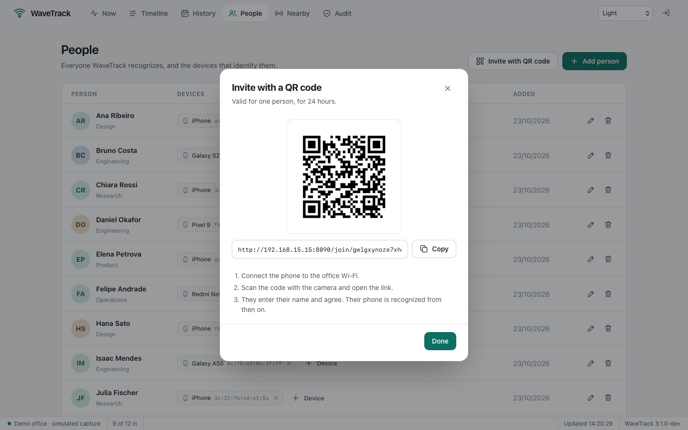

A pessoa conecta no Wi-Fi do escritório, escaneia, digita o nome e concorda. O WaveTrack identifica o celular pela própria rede; nunca confia num endereço que o aparelho alega.

| Claro | Escuro |
| --- | --- |
| 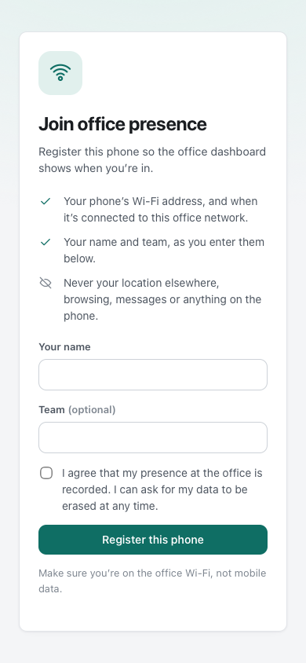 | 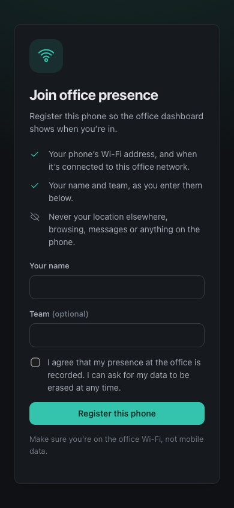 |

**Opção B, manualmente.** **Add person** recebe nome, equipe e, se quiser, o MAC de um aparelho (no iPhone: *Ajustes › Wi-Fi › ⓘ › Endereço Wi-Fi*).

**Opção C, em Por perto.** **Nearby** lista aparelhos vistos que não são de ninguém; escolha uma pessoa no menu para atribuir.

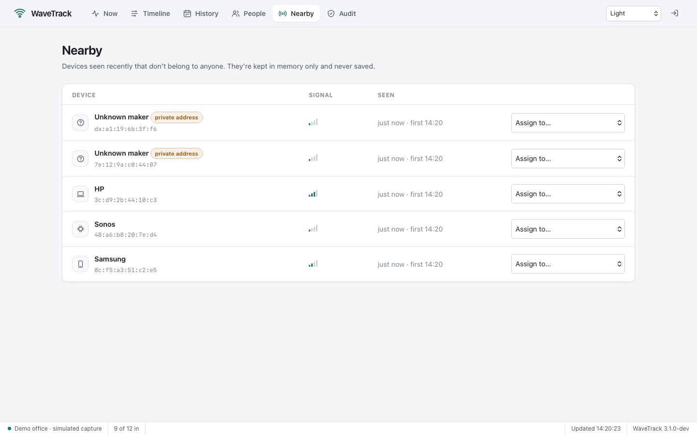

## 5. No dia a dia

| Agora | Linha do tempo | Histórico |
| --- | --- | --- |
| 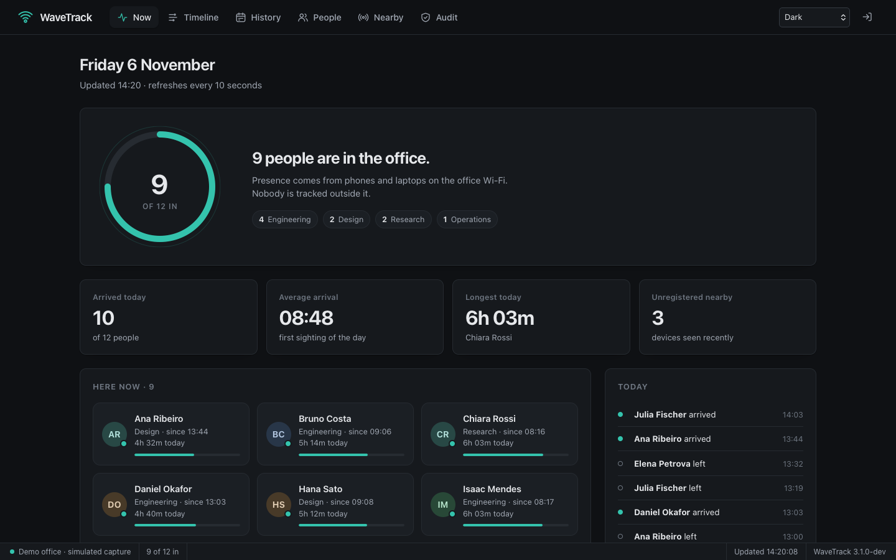 | 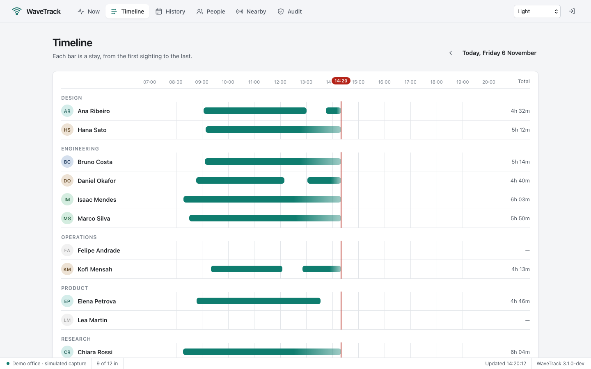 | 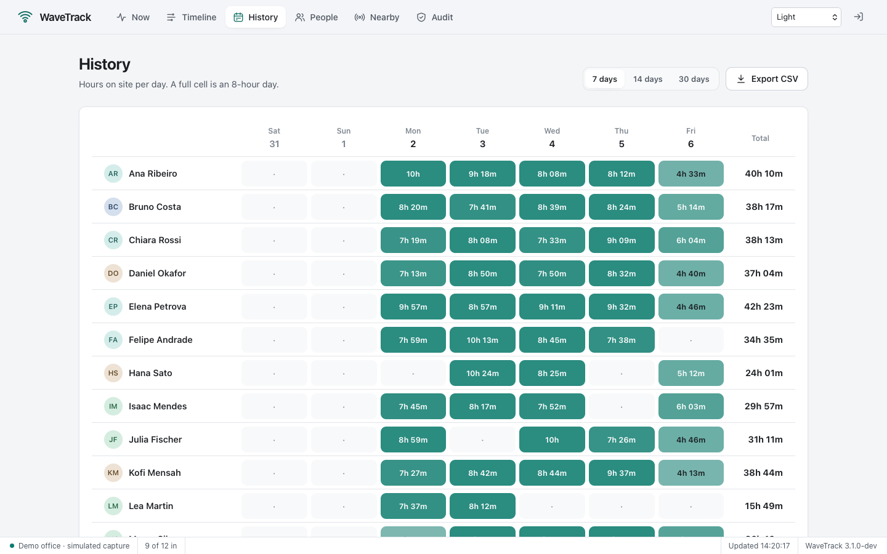 |

### Auditoria

A tela **Audit** lista cada ação administrativa, da mais recente para a mais antiga: entradas no painel (inclusive as que falharam), pessoas adicionadas, editadas, anonimizadas ou apagadas, aparelhos, convites e exportações, com a sessão do navegador e o endereço de origem. Dá para filtrar, carregar mais e exportar em CSV.

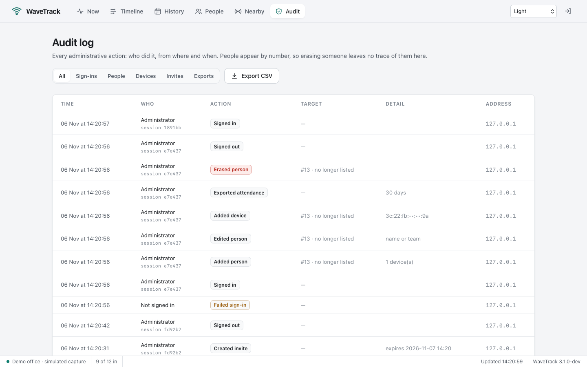

As pessoas aparecem por número (a tela mostra o nome atual ao lado) e os aparelhos com o meio do endereço mascarado: apagar alguém não deixa dado pessoal no registro, mas o registro de que houve a exclusão fica.

### Temas

Escolha o tema no menu da barra superior; a escolha fica salva no navegador. **System** acompanha o claro ou escuro do sistema.

| Classic: um aplicativo de desktop do Windows 2000 | Code: o visual escuro de um editor de código |
| --- | --- |
| 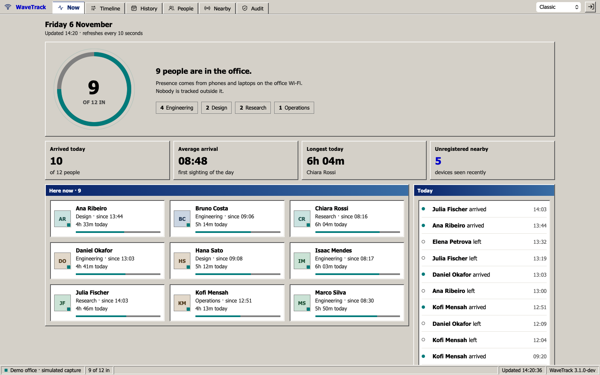 | 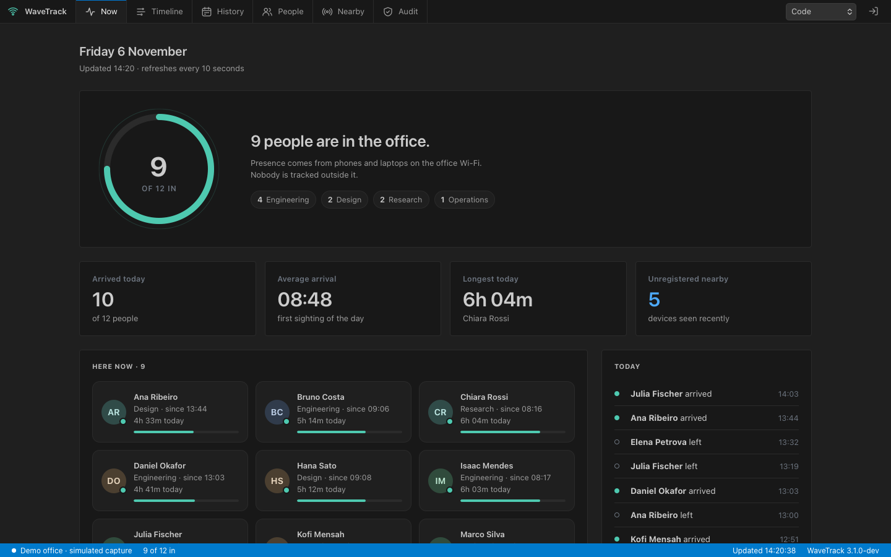 |

Há ainda **Light**, **Dark** e **High contrast** (preto, branco e cores de sinal saturadas, para baixa visão). Em todos, a presença tem uma cor própria: barra ou ponto colorido sempre quer dizer "no escritório".

## 6. Privacidade

- **Só aparelhos cadastrados vão para o disco.** Os demais ficam um tempo na memória (para a tela Por perto) e nunca são gravados.
- **O consentimento é registrado** em quem se cadastra sozinho.
- **Duas formas de remover alguém:** *anonimizar* (troca o nome, esquece os aparelhos, mantém as horas) ou *apagar tudo* (pessoa, aparelhos e visitas), para pedidos sob a LGPD.

  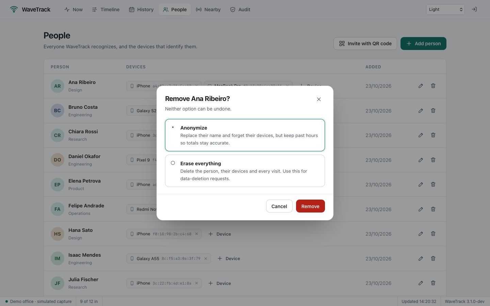

- **Retenção:** visitas mais antigas que `privacy.retention_days` (365 por padrão) são apagadas automaticamente, e registros de auditoria depois de `privacy.audit_retention_days` (730).
- **Nada sai do prédio:** sem contas, nuvem ou telemetria.
- **Painel protegido:** token de administrador, cookies `HttpOnly` e `SameSite=Strict`, bloqueio de requisições de outros sites, CSP estrita e limite de tentativas de login.

## 7. Configuração, serviço e API

Tudo é opcional: copie [`config.example.yaml`](config.example.yaml) para `config.yaml`. Para servir o painel em **HTTPS**, preencha `tls.cert_file` e `tls.key_file`; faça isso sempre que o Wi-Fi do escritório for compartilhado. Arquivos prontos para rodar como serviço estão em [`deploy/`](deploy) (systemd sem root e com restrições de kernel e rede no Linux, launchd no macOS). A API e a configuração estão detalhadas no [README em inglês](README.md#7-configuration).

## 8. Segurança e desempenho

- **Segurança:** a [revisão de segurança](docs/security.md) traz o modelo de ameaças, cada controle, os achados da revisão da 3.1 com a correção de cada um e os riscos aceitos de propósito. Para reportar uma vulnerabilidade, veja [SECURITY.md](SECURITY.md).
- **Desempenho:** com 100 pessoas e um ano de histórico, a atualização do painel caiu de 5,8 ms para 0,42 ms, e com dez painéis abertos ao mesmo tempo, de 6,3 ms para 0,16 ms por requisição. Método e números completos em [docs/benchmarks.md](docs/benchmarks.md); reproduza com `make bench`.

## 9. Como funciona

Celulares e notebooks se anunciam o tempo todo na rede (ARP, DHCP, descoberta de vizinhos IPv6 e mDNS). O WaveTrack escuta esses pacotes, anota o endereço de hardware de quem enviou e transforma avistamentos em **visitas**: do primeiro avistamento até o último, depois de `away_after` sem nenhum. As decisões de projeto estão em [docs/architecture.md](docs/architecture.md).

## 10. Vindo da 2.x

```bash
wavetrack import-v2 data/wavetrack.db --data data-v3
wavetrack --data data-v3
```

Licença MIT · Lucas Rafaldini
